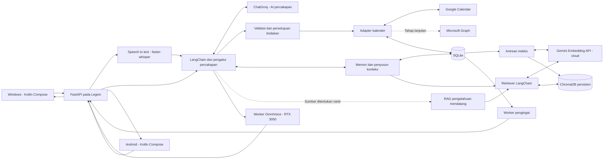
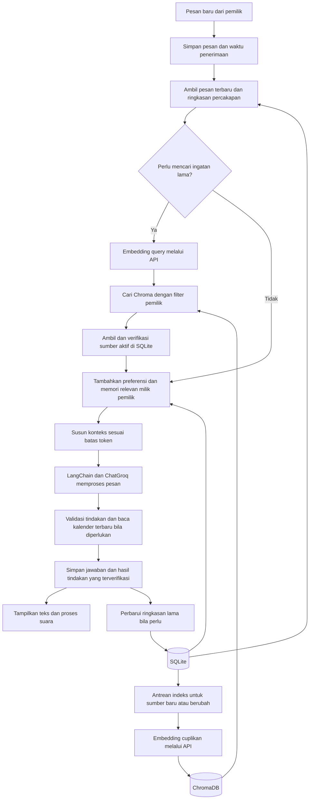
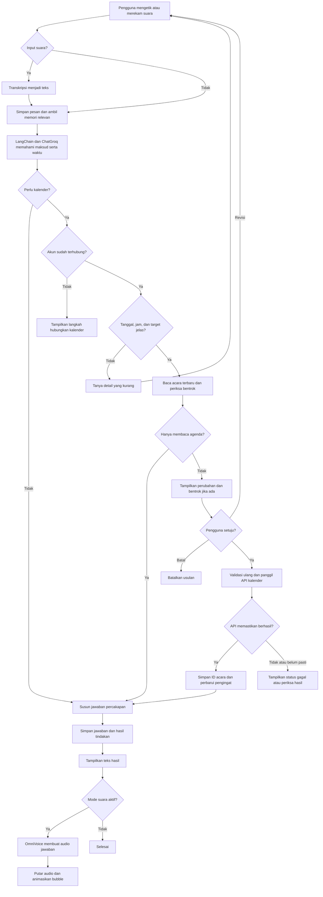
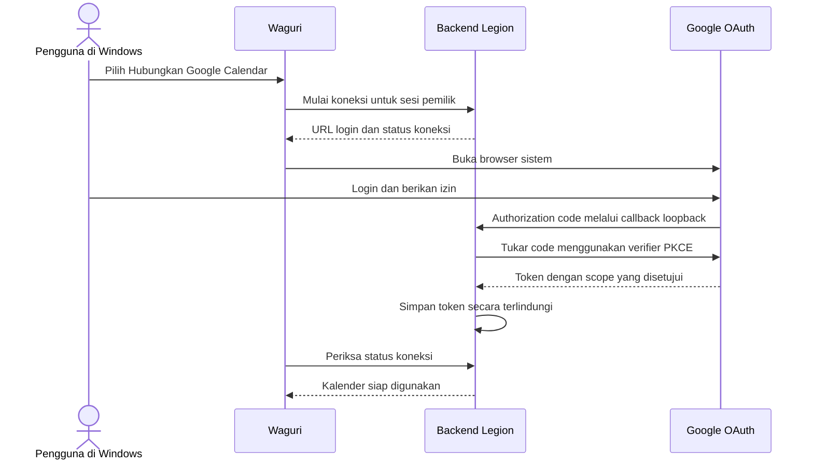

# Rencana Proyek Waguri Personal Assistant

Tanggal rencana: 15 Oktober 2026. Status: rancangan implementasi; integrasi dan model belum dipasang atau diuji pada Legion.

Keputusan pengguna: aplikasi Windows dan Android menggunakan Kotlin, suara kloning menggunakan OmniVoice, karakter awal berbentuk bubble. Memori percakapan menjadi fitur inti, dengan LangChain dan vector database sebagai bagian resmi stack. Embedding menggunakan API sesuai pilihan pengguna agar laptop tidak memuat model embedding lokal. Rekomendasi provider awal adalah Gemini Embedding 2; vector database tetap ChromaDB lokal. Tujuan serta sumber pengetahuan RAG baru masih akan ditentukan; fondasi teknologinya sudah dipilih. Dokumen ini menetapkan Google Calendar sebagai integrasi pertama dan Microsoft Calendar sebagai tahap berikutnya.

## 1. Hasil yang ingin dicapai

Pengguna dapat mengetik atau berbicara dalam bahasa Indonesia untuk melihat agenda, membuat acara pada tanggal dan jam tertentu, memindahkan jadwal, dan menghapus acara. Waguri menampilkan hasil di layar dan membacakannya menggunakan suara referensi yang dipilih.

Versi pertama digunakan oleh satu pemilik pada Windows dan Android. Backend serta layanan suara berjalan di laptop Legion RTX 3050. Android terhubung ke backend yang sama, sehingga jadwal dan percakapan mengacu pada akun yang sama.

Target awal:

- Chat teks dan tombol tekan-untuk-bicara.
- Riwayat percakapan tersimpan, dapat dilanjutkan setelah restart dan dari perangkat lain milik pemilik yang sama.
- Konteks percakapan terakhir, ringkasan chat lama, serta preferensi yang diminta pengguna untuk diingat.
- Pencarian semantik terhadap percakapan tersimpan, dengan referensi ke pesan asli dan pembatasan pemilik.
- Bubble dengan status diam, mendengarkan, memproses, menunggu konfirmasi, dan berbicara.
- Agenda hari ini, besok, dan rentang tanggal pilihan.
- Membuat, mengubah, dan menghapus acara tunggal.
- Zona waktu awal `Asia/Jakarta`, dapat diganti di pengaturan.
- Pratinjau perubahan kalender sebelum pengguna menyetujui.
- Pengingat kalender; suara pengingat Waguri saat aplikasi aktif.

Tahap lanjutan: perumusan dan implementasi RAG baru, percakapan tanpa tombol, interupsi suara, acara berulang, Microsoft Calendar, akses dari luar rumah, avatar 2D/3D, dan bubble yang mengambang di atas aplikasi lain. Bubble versi pertama berada di dalam jendela aplikasi. Overlay Android dan Windows memerlukan implementasi terpisah.

## 2. Tech stack yang dipilih

| Bagian | Pilihan | Peran dalam proyek |
|---|---|---|
| Bahasa aplikasi | Kotlin | Logika klien bersama |
| Kerangka lintas platform | Kotlin Multiplatform | Membagi kode Android dan Windows |
| Antarmuka | Compose Multiplatform | Chat, agenda, bubble, pengaturan |
| Aplikasi Windows | Compose Desktop pada JVM | Aplikasi desktop yang dikemas untuk Windows |
| Jaringan klien | Ktor Client, kotlinx.serialization, Coroutines | HTTP, WebSocket, JSON, pekerjaan asinkron |
| Tanggal pada klien | kotlinx-datetime | Menampilkan waktu sesuai zona pengguna |
| Backend | Python + FastAPI + Pydantic | API, validasi perintah, sesi, kalender |
| Penghubung alur AI | LangChain Python / LCEL, `langchain-core` | Menyusun pesan, konteks, retriever, hasil terstruktur, dan definisi tools |
| AI percakapan | Groq melalui `ChatGroq` dari `langchain-groq` | Menghasilkan jawaban dan usulan tindakan terstruktur |
| Pengenalan ucapan | faster-whisper | Mengubah audio menjadi teks |
| Kloning dan sintesis | OmniVoice + PyTorch CUDA | Membuat audio jawaban pada RTX 3050 |
| Deteksi ucapan tahap lanjutan | Silero VAD | Menentukan mulai dan akhir ucapan |
| Database backend | SQLite + SQLAlchemy + Alembic | Riwayat, ringkasan, preferensi, sesi, usulan tindakan, cache acara, pengingat, migrasi |
| Memori percakapan | LangChain + modul memori Python + SQLite | Menyusun riwayat, ringkasan, preferensi, dan hasil pencarian dengan batas konteks |
| Model embedding | Gemini API: `gemini-embedding-2`, SDK `google-genai` dalam adapter `Embeddings` LangChain | Mengubah teks menjadi vektor di layanan eksternal; tanpa memuat model embedding pada laptop |
| Vector database | ChromaDB lokal persisten + `langchain-chroma` | Menyimpan embedding dan metadata untuk pencarian semantik |
| RAG mendatang | LangChain + embedding API + ChromaDB | Fondasi dipilih; sumber data, kebijakan pemotongan dokumen, dan evaluasi domain ditentukan kemudian |
| Cache perangkat | SQLDelight / SQLite | Agenda terakhir dan draft lokal pada Android/Windows; bukan tempat token OAuth |
| Kalender pertama | Google Calendar API + OAuth 2.0 | Baca dan kelola acara |
| Kalender lanjutan | Microsoft Graph + OAuth 2.0 | Baca dan kelola kalender Outlook |
| Pengingat aplikasi | Worker Python terpisah dengan antrean tersimpan di database | Memproses jadwal pengingat tanpa bergantung pada layar chat |

Kotlin adalah bahasanya; Kotlin Multiplatform dan Compose Multiplatform adalah kerangka aplikasi yang dipilih. Python tetap dipakai karena logika lama dan model suara berada di ekosistem tersebut. Dukungan berbagi UI Android dan desktop dijelaskan dalam [dokumentasi Compose Multiplatform](https://kotlinlang.org/docs/multiplatform/compose-multiplatform-new-project.html).

Perekaman mikrofon, pemutaran audio, notifikasi, dan penyimpanan kredensial perangkat dibungkus dalam interface bersama dengan implementasi Android dan Windows masing-masing. Berbagi kode tidak berarti semua API perangkat identik.

Versi Kotlin, Compose, Gradle, JDK, LangChain beserta paket integrasinya, ChromaDB, google-genai, PyTorch, dan CUDA dikunci setelah kombinasi build serta inference berhasil. Dependensi backend dan OmniVoice memakai virtual environment terpisah agar perubahan model tidak merusak layanan kalender. ID model API, dimensi, dan konfigurasi preprocessing dicatat bersama versi indeks; perubahan layanan tetap dipantau karena model cloud tidak dikendalikan laptop.

### Peran LangChain dalam aplikasi baru

LangChain dipakai pada backend Python untuk menghubungkan komponen AI; aplikasi Kotlin tetap berkomunikasi dengan FastAPI. `ChatPromptTemplate` dan format pesan LangChain membawa instruksi asisten, histori terpilih, hasil retrieval, serta pesan terbaru ke `ChatGroq`. Rangkaian LCEL digunakan untuk langkah yang urutannya tetap. Peringkasan riwayat memakai adapter model yang sama.

Tools kalender didefinisikan dengan schema yang jelas dan dihubungkan ke model melalui tool calling. Model mengusulkan nama fungsi serta parameter; executor backend memeriksa kepemilikan, tanggal, pratinjau, dan persetujuan sebelum menulis ke kalender. Hasil eksekusi diberikan kembali sebagai tool result untuk menyusun jawaban. Uji dukungan tool calling dan structured output pada model Groq yang dipilih; batasi jumlah langkah dan jangan mengubah retry menjadi pengulangan tindakan tulis. [Integrasi ChatGroq](https://docs.langchain.com/oss/python/integrations/chat/groq), [model dan tool calling LangChain](https://docs.langchain.com/oss/python/langchain/models).

Retriever LangChain menghubungkan embedding dan ChromaDB untuk memori semantik serta RAG nanti. Penyimpanan riwayat, kontrol retensi, OAuth, pengingat, dan idempotensi tetap dikelola backend. LangGraph belum menjadi dependensi wajib; alur terbatas ini dapat dibangun dengan LangChain dan state tindakan dalam SQLite. LangSmith juga tidak diperlukan untuk menjalankan MVP.

### Pembagian SQLite, embedding, dan ChromaDB

| Komponen | Menyimpan atau mengerjakan apa | Kedudukan data |
|---|---|---|
| SQLite | Teks asli, waktu pesan, ringkasan, preferensi, ID acara, status tindakan, dan antrean indeks | Penyimpanan utama data aplikasi |
| Embedding API | Mengirim teks terpilih ke provider dan menerima vektor | Pemrosesan eksternal; penyimpanan aplikasi tetap SQLite/Chroma |
| ChromaDB | Vektor, metadata sumber, serta cuplikan terpilih yang dapat dibangun ulang | Indeks turunan untuk pencarian; bukan penentu kebenaran jadwal |
| Google/Microsoft Calendar | Acara dan waktu terkini yang sudah tersimpan pada provider | Sumber kebenaran jadwal |

ChromaDB dipilih untuk MVP karena memiliki penyimpanan lokal persisten, operasi tambah/perbarui/hapus, filter metadata, dan integrasi LangChain. Jalankan dengan direktori persisten di luar Git; tidak memerlukan langganan Chroma Cloud. Satu proses backend memiliki akses langsung ke direktori indeks pada MVP. Worker pengingat tidak membukanya; bila perlu beberapa proses pembaca/penulis, gunakan Chroma server lokal sebagai pemilik indeks. [Dokumentasi Chroma untuk LangChain](https://docs.langchain.com/oss/python/integrations/vectorstores/chroma).

Rekomendasi awal: `gemini-embedding-2` untuk teks, dengan output 768 dimensi agar indeks lokal lebih kecil daripada output default. Kualitas pencarian bahasa Indonesia tetap diuji. Adapter mengikuti interface `Embeddings` LangChain dan memanggil SDK `google-genai`. Untuk model ini gunakan format query `task: search result | query: {teks}` dan dokumen `title: {judul} | text: {teks}`; gunakan judul `none` bila tidak ada. Jangan mengirim parameter `task_type` model generasi sebelumnya. Pastikan satu vektor per cuplikan, bukan satu vektor gabungan untuk seluruh batch. [Dokumentasi Gemini embeddings](https://ai.google.dev/gemini-api/docs/embeddings).

Laptop hanya menjalankan pemotongan teks, pengiriman request, dan pencarian Chroma; bobot model embedding tidak diunduh. Mulai dengan cuplikan sekitar 1.000 karakter dan overlap 150 karakter pada batas kalimat, lalu ukur kualitas dan validasi batas input provider tanpa truncation diam-diam. Teks lengkap tetap di SQLite. Pengindeksan berjalan di latar belakang dengan konkurensi terbatas. Cache berdasarkan pemilik, hash teks, model, dimensi, dan format retrieval mencegah embedding ulang teks yang sama; cache ikut dihapus sesuai sumber dan retensi.

Tangani timeout, koneksi putus, serta HTTP 429 dengan retry terbatas dan backoff. Antrean disimpan di SQLite agar dapat dilanjutkan; sumber aktif diperiksa sebelum request dan sebelum menyimpan hasil. Jika embedding query gagal, gunakan konteks terbaru serta pencarian tanggal/kata kunci SQLite. Gangguan embedding tidak boleh menghalangi operasi kalender yang tidak membutuhkan pencarian semantik. Catat penggunaan dan batasi request/token harian dari aplikasi sesuai kuota proyek. [Batas penggunaan Gemini](https://ai.google.dev/gemini-api/docs/rate-limits).

API key embedding disimpan hanya di backend, terpisah dari token OAuth kalender dan kunci Groq. API key tidak memberikan akses otomatis ke akun atau kalender Google. Hanya teks yang dikirim backend yang diproses provider. Jangan kirim kredensial atau chat sementara untuk pengindeksan. Untuk prototipe gratis gunakan data uji nonpribadi; pemakaian memori pribadi memerlukan pilihan layanan/tier dengan ketentuan data yang sesuai. Menghapus data lokal tidak menjamin penghapusan data yang telah diproses provider.

Gunakan collection `conversation_memory_gemini2_768_v1` untuk cuplikan percakapan dan ringkasan yang diizinkan, serta `knowledge_gemini2_768_v1` untuk sumber RAG mendatang. Collection pengetahuan belum diisi sebelum sumbernya ditentukan. Setiap entri memiliki `owner_id`, `source_type`, `source_id`, `source_version`, timestamp, dan ID chunk stabil. Kedua collection memakai cosine distance. Aturan chunking dokumen pengetahuan disesuaikan setelah jenis dokumennya diketahui.

Pembaruan indeks dijadwalkan melalui tabel `index_job` di SQLite dalam transaksi yang sama dengan pembaruan sumber. Pekerja indeks dalam proses pemilik Chroma menjalankan upsert/delete yang dapat dicoba ulang. Tidak ada asumsi transaksi atomik lintas SQLite dan Chroma. Metadata versi dan status penghapusan di SQLite selalu diperiksa sebelum hasil retrieval dimasukkan ke prompt, sehingga indeks yang tertinggal tidak menghidupkan kembali data lama.

Filter pemilik dan pengaturan memori diterapkan sebelum pencarian. Untuk pertanyaan yang membutuhkan ingatan lama, ambil kandidat terbatas dari Chroma, mulai dari lima cuplikan, verifikasi sumber aktif di SQLite, lalu deduplikasi dan sesuaikan batas konteks. Kalibrasikan ambang relevansi pada contoh Indonesia; skor kemiripan bukan probabilitas kebenaran. Jika indeks belum siap atau tidak menemukan hasil yang cukup relevan, gunakan riwayat terbaru dan pencarian tanggal/kata kunci, atau nyatakan informasi belum ditemukan.

Perubahan model embedding, prefix, dimensi, atau aturan chunking menggunakan versi collection baru dan reindex dari sumber aktif. Indeks FAISS lama tidak disalin langsung ke Chroma karena model embedding berubah. Penghapusan mencakup vektor, cuplikan, dan metadata; indeks bisa dibangun ulang dari SQLite tanpa mengimpor kembali sumber yang telah dilupakan. Kredensial dan chat sementara tidak diindeks.

## 3. Arsitektur dan tempat program berjalan



Klien mengirim audio atau teks, backend memproses, lalu klien menerima teks dan audio hasil. Groq, embedding API, dan kalender membutuhkan internet. OmniVoice berjalan lokal; keberhasilan suara lokal tidak membuat seluruh asisten otomatis offline.

Untuk prototipe, Windows mengakses backend melalui loopback. Android memakai koneksi HTTPS tepercaya atau jaringan privat terenkripsi ke Legion, dengan pairing perangkat sekali pakai. Pairing dibatasi satu pemilik dan menghasilkan sesi perangkat yang dapat dicabut. Jangan membuka endpoint kalender tanpa autentikasi ke jaringan umum.

Jika Legion mati atau tidur, chat yang memerlukan backend dan sintesis suara baru tidak tersedia. Acara yang sudah disimpan tetap berada di Google Calendar. Pengingat aplikasi Google Calendar mengikuti sinkronisasi dan pengaturan notifikasi perangkat, tidak bergantung pada proses Python Waguri.

## 4. Perubahan dari kode Waguri yang sekarang

Pada saat rencana dibuat:

- `app.py` berisi UI Streamlit, histori tampilan, dan pemutaran gTTS.
- `engine.py` berisi `WaguriBrain`, model Groq, serta eksperimen pencarian dokumen melalui FAISS.
- Riwayat di UI belum diteruskan sebagai riwayat percakapan lengkap ke chain pada engine.
- Belum ada OAuth kalender, action executor, penerimaan mikrofon, atau layanan OmniVoice.

Implementasi dilakukan bertahap: pertahankan integrasi LangChain/ChatGroq dari `engine.py` dalam adapter yang terpisah, tambahkan penyimpanan riwayat dan penyusun konteks, lalu hadirkan API FastAPI. Fitur tanya-jawab dokumen lama beserta prompt dan kewajiban memuat FAISS tidak dibawa ke aplikasi baru. ChromaDB dan embedding API menggantikan fondasi pencarian lama; prompt baru berfokus pada asisten pribadi dan pengelolaan jadwal.

Fondasi RAG baru memakai LangChain, embedding API, dan ChromaDB. Kebutuhan, sumber pengetahuan, format dokumen, serta evaluasi retrieval domain ditentukan bersama pengguna kemudian. Memori semantik atas percakapan tersimpan dapat dibangun lebih dahulu dengan stack tersebut tanpa menunggu sumber RAG tambahan.

UI Kotlin memakai API baru. Streamlit dapat dipertahankan sebagai alat uji selama transisi. Tidak ada kewajiban menulis ulang model AI dalam Kotlin.

### Memori percakapan yang akan dibangun

Sistem ini memungkinkan Waguri mengingat informasi yang tersimpan ketika aplikasi dibuka kembali. Model tidak otomatis menyimpan ingatan dari setiap panggilan API; backend mengambil konteks yang sesuai lalu mengirimkannya bersama pesan baru. Pembagian memori dalam satu percakapan dan memori lintas percakapan juga dijelaskan dalam [konsep memori LangChain](https://docs.langchain.com/oss/python/concepts/memory). LangChain menyusun konteks dan menghubungkan retriever; modul memori Python mengatur penyimpanan SQLite, indeks Chroma, dan siklus hidup data.

| Lapisan | Isi | Perilaku yang diharapkan |
|---|---|---|
| Riwayat tersimpan | Pesan pengguna, jawaban, waktu, dan hasil tindakan dengan statusnya | Chat tetap tersedia setelah backend restart; Windows dan Android dapat membuka percakapan yang sama |
| Konteks aktif | Pesan terbaru dan referensi tindakan/acara yang sedang dibahas | “Pindahkan yang tadi ke jam delapan malam” merujuk pada acara yang benar |
| Ringkasan percakapan | Topik, keputusan, dan hal yang belum selesai dari bagian chat yang lebih lama | Percakapan panjang dapat dilanjutkan tanpa mengirim seluruh riwayat |
| Memori lintas percakapan | Preferensi yang dinyatakan pengguna, misalnya durasi belajar atau menit pengingat | Chat baru dapat memakai preferensi yang masih berlaku |
| Memori semantik | Embedding cuplikan chat/ringkasan dengan ID sumber aktif di SQLite | Menemukan obrolan lama meskipun pertanyaan baru menggunakan kata berbeda |

Contoh: pengguna mengatakan “Ingat, kalau aku menjadwalkan belajar, durasinya biasanya satu jam.” Backend menyimpan preferensi beserta sumber pesannya. Pada percakapan berikutnya, “Jadwalkan belajar besok jam tujuh malam” dapat memakai durasi tersebut, tetap menampilkannya pada pratinjau. Pengguna dapat memperbaruinya menjadi 45 menit atau meminta Waguri melupakannya.

Alur penyusunan konteks:



Aturan implementasi memori:

- Pesan memiliki `owner_id`, `conversation_id`, urutan, timestamp, dan ID permintaan untuk mencegah penyimpanan ganda. Melanjutkan chat lama memakai ID yang sama; chat baru tetap menjadi percakapan terpisah.
- Simpan riwayat di disk. `session_state` atau variabel dalam RAM saja tidak cukup untuk memulihkan percakapan setelah restart.
- Penyusun konteks memilih pesan terbaru, ringkasan yang relevan, dan preferensi pengguna. Sisakan anggaran token untuk jawaban dan hasil tool; jangan mengirim semua chat sepanjang waktu. Pasangan tool call dan hasilnya tetap utuh.
- Ringkasan menyimpan versi dan batas pesan terakhir yang sudah diringkas. Pesan setelah batas itu disertakan secara langsung sehingga tidak hilang saat peringkasan berjalan di latar belakang. Gunakan rangkaian LangChain dan ChatGroq untuk peringkasan; kegagalan proses ini tidak boleh merusak chat utama.
- Untuk pertanyaan tentang obrolan lama, gunakan pencarian semantik Chroma dan verifikasi cuplikan sumber di SQLite. Pencarian tanggal, judul, atau kata kunci tetap tersedia untuk kebutuhan pasti dan fallback. Sumber pengetahuan RAG tambahan tetap ditentukan kemudian.
- Simpan preferensi jangka panjang dari perintah eksplisit seperti “ingat...” atau pengaturan pengguna. Jangan mengubah tebakan model, kutipan, atau cerita tentang orang lain menjadi fakta tentang pemilik.
- Memori memiliki sumber pesan, waktu diperbarui, status aktif/digantikan, dan masa berlaku bila relevan. Koreksi pengguna menggantikan nilai lama; jika dua fakta tidak dapat diselesaikan dengan jelas, tanyakan kembali.
- Tanggal relatif pada pesan lama mengikuti waktu pesan aslinya. “Besok” dalam chat minggu lalu tidak dihitung ulang sebagai besok pada hari ini.
- Kalender tetap sumber kebenaran jadwal. Ingatan “rapat jam sembilan” harus diperiksa terhadap acara terbaru sebelum dipakai untuk mengubah jadwal. ID acara dan status tindakan disimpan terstruktur, tidak hanya di ringkasan bahasa alami.
- Ingatan tentang rencana atau persetujuan lama tidak menjalankan tindakan baru secara otomatis. Usulan kedaluwarsa tetap memerlukan validasi ulang dan persetujuan sesuai alur kalender.
- Semua query dibatasi pemilik. Memori dan cuplikan riwayat adalah data konteks, bukan instruksi yang boleh mengubah aturan aplikasi atau izin tool.
- Sediakan tampilan Riwayat dan Memori Tersimpan, dengan fungsi lihat, koreksi, hapus, serta pengaturan memori lintas percakapan. Chat sementara tidak disimpan dalam riwayat persisten dan tidak menghasilkan memori jangka panjang; log teknisnya tidak memuat isi chat. Status operasi kalender yang diperlukan untuk mencegah duplikasi tetap ditangani terpisah dan dijelaskan di UI.
- Menghapus percakapan menghapus atau menghitung ulang ringkasan serta memori turunan yang mengacu padanya. Hapus juga cache terkait pada perangkat saat sinkronisasi; pekerjaan peringkasan tertunda tidak boleh menghidupkan kembali data yang telah dihapus. Memori yang diminta dilupakan ditandai agar tidak otomatis diekstrak lagi dari riwayat tersisa.

Kemampuan mengingat bergantung pada data yang disimpan dan konteks yang berhasil ditemukan; tidak dijanjikan mengingat setiap kata secara sempurna. Jika tidak menemukan bukti riwayat, Waguri menyatakan belum menemukan informasinya. Lapisan ini memakai penyimpanan SQLite/Chroma, embedding melalui API, dan konteks model. Ringkasan serta konteks tambahan tetap memakai kuota token Groq.

## 5. Alur percakapan dan tindakan kalender



Melalui tools LangChain, AI mengusulkan fungsi dengan parameter terstruktur, misalnya `list_events`, `find_free_slots`, `propose_create_event`, `propose_update_event`, dan `propose_delete_event`. Backend hanya menyediakan fungsi yang diizinkan; tool tulis membuat usulan, sedangkan endpoint konfirmasi menjalankan perubahan sebenarnya. ID pengguna dan akun kalender diambil dari sesi server, bukan dipercaya dari keluaran model.

Untuk versi pertama, tindakan tulis membutuhkan persetujuan atas pratinjau. Tombol Simpan, Ubah, atau Hapus mengonfirmasi `proposal_id` tertentu. Model tidak dapat mengonfirmasi usulannya sendiri. Usulan menyimpan versi, pemilik, waktu kedaluwarsa, dan isi perubahan; revisi menghasilkan versi baru yang perlu disetujui lagi.

Judul atau deskripsi acara diperlakukan sebagai data, bukan instruksi untuk AI. Pertanyaan ambigu, kegagalan transkripsi, dan hasil pencarian yang memiliki beberapa acara harus diselesaikan sebelum tindakan dijalankan.

Backend baru menyatakan berhasil setelah memperoleh hasil API yang sah. Jika koneksi terputus setelah request terkirim, status sementara menjadi belum pasti; periksa ID acara sebelum mencoba ulang. Gunakan ID operasi tetap dan ID acara Google yang valid untuk mencegah duplikasi akibat retry. Perubahan acara menggunakan versi/ETag untuk mendeteksi edit bersamaan. Google mendokumentasikan ID acara buatan klien sebagai cara menghindari duplikasi dalam [panduan membuat acara](https://developers.google.com/workspace/calendar/api/guides/create-events).

## 6. Tanggal, jam, durasi, dan bentrok

Contoh berikut menggunakan waktu percakapan ilustratif **15 Oktober 2026 di Asia/Jakarta**:

> “Waguri, jadwalkan belajar Python besok jam tujuh malam selama satu jam. Ingatkan lima belas menit sebelumnya.”

Pratinjau yang ditampilkan:

| Detail | Nilai |
|---|---|
| Judul | Belajar Python |
| Tanggal | 16 Oktober 2026 |
| Waktu | 19.00–20.00 WIB |
| Pengingat | 18.45 WIB |
| Kalender | Kalender pribadi Google yang dipilih |

Representasi internal usulan:

```json
{
  "action": "create_event",
  "title": "Belajar Python",
  "start": "2026-10-16T19:00:00+07:00",
  "end": "2026-10-16T20:00:00+07:00",
  "timezone": "Asia/Jakarta",
  "reminder_minutes_before": 15,
  "all_day": false
}
```

Aturan implementasi:

- Sertakan waktu saat pesan diterima dan zona pengguna pada konteks model. Kata “besok” dihitung dari tanggal lokal pengguna, termasuk saat mendekati tengah malam.
- Normalisasi dengan datetime yang memiliki zona waktu. Backend memvalidasi keluaran model memakai Pydantic dan `zoneinfo`; simpan waktu absolut dalam UTC beserta zona IANA asal.
- “Jam tujuh” tanpa konteks pagi/malam ditanyakan kembali. “Nanti sore” membutuhkan jam tertentu sebelum menyimpan acara berjam.
- Durasi yang belum diberikan memakai preferensi eksplisit pengguna, atau ditanyakan. Default yang dipakai harus terlihat pada pratinjau.
- Waktu selesai harus setelah waktu mulai. Tanggal lampau dan perbedaan zona ditunjukkan secara jelas.
- Acara sepanjang hari memakai tanggal, bukan pukul 00.00 buatan; tanggal selesai bersifat eksklusif. Dukungan ini ditambahkan setelah acara berjam stabil.
- Untuk pindah/hapus, tampilkan pilihan jika ada lebih dari satu acara yang cocok. Gunakan ID acara, bukan judul saja.
- Periksa tumpang tindih terhadap kalender yang dipilih untuk pemeriksaan. Kalender lain yang tidak dibaca tidak ikut dianggap bebas.
- Jika bentrok, tawarkan alternatif atau izinkan pengguna memilih tetap menyimpan. API kalender umumnya tidak melarang acara bertumpuk.
- Periksa ulang acara terbaru tepat sebelum menulis. Tidak ada transaksi lintas kalender yang menjamin bentrok mustahil terjadi saat pihak lain mengedit bersamaan.
- Saat mendukung pengulangan, bedakan satu kejadian dan seluruh rangkaian. Perhitungan pengulangan mengikuti zona kalender, termasuk perubahan DST bila zona lain digunakan.

Semantik waktu dan acara sepanjang hari merujuk [konsep acara Google Calendar](https://developers.google.com/workspace/calendar/api/concepts/events-calendars); pengulangan merujuk [panduan recurring events](https://developers.google.com/workspace/calendar/api/guides/recurringevents).

## 7. Menghubungkan Google dan Microsoft Calendar

Prototipe satu pemilik menghubungkan Google pertama kali dari Windows. Aktifkan Calendar API, buat OAuth client jenis Desktop, lalu jalankan authorization code flow melalui browser sistem dengan PKCE dan callback loopback di Legion. Callback loopback ini untuk alur desktop, bukan URL yang disuruh dibuka di HP. Android kemudian menggunakan sesi Waguri yang telah dipasangkan dengan pemilik yang sama. [OAuth aplikasi desktop Google](https://developers.google.com/identity/protocols/oauth2/native-app).



Scope awal untuk kalender milik sendiri adalah `calendar.events.owned.readonly` saat uji baca, lalu `calendar.events.owned` saat mengaktifkan pengelolaan acara. Tambahkan `calendar.calendarlist.readonly` bila pengguna perlu memilih kalender. Kalender bersama memerlukan evaluasi scope `calendar.events` dan izin tulis akun. Pembatasan ke kalender pilihan ditegakkan juga di backend, karena scope OAuth bisa lebih luas dari satu kalender. [Daftar scope resmi](https://developers.google.com/workspace/calendar/api/auth).

Refresh token disimpan terlindungi di backend; kunci enkripsi menggunakan penyimpanan kredensial OS. Token Google tidak diberikan ke model, aplikasi Android, atau log. Sesi perangkat Android disimpan menggunakan penyimpanan yang dilindungi Android Keystore. Siapkan refresh token, penanganan izin dicabut, tombol Putuskan Koneksi, dan login ulang. Status OAuth testing dan persyaratan publikasi Google diperiksa sebelum distribusi.

Untuk penggunaan mandiri dari Android tanpa setup awal Windows, backend harus memiliki alamat HTTPS tetap. Gunakan OAuth web-server flow dengan callback server yang terdaftar, state yang terikat ke sesi, dan penyelesaian koneksi lewat kanal aplikasi terautentikasi. Jangan membawa client secret web ke APK. [OAuth web-server Google](https://developers.google.com/identity/protocols/oauth2/web-server).

Microsoft ditambahkan setelah Google stabil melalui interface `CalendarProvider` yang sama. Gunakan izin delegated `Calendars.ReadWrite`, tangani consent organisasi, serta petakan format tanggal dan zona waktu ke format Graph. Buat ID operasi/transaction ID dan mekanisme versi yang sesuai provider. Koneksi dua penyedia tidak otomatis berarti menyalin semua acara antar-kalender. [API acara Microsoft Graph](https://learn.microsoft.com/en-us/graph/api/user-post-events?view=graph-rest-1.0).

## 8. Pipeline suara OmniVoice

OmniVoice menjadi model TTS utama. Suara referensi tidak dipakai sebagai model percakapan. Pengenalan pertanyaan ditangani faster-whisper; keputusan jadwal ditangani backend dan AI.

Percobaan pada Legion dilakukan sebelum integrasi penuh:

1. Catat VRAM RTX 3050, RAM, CPU, driver, dan memori GPU yang tersedia. Spesifikasi VRAM/RAM Legion belum dikonfirmasi.
2. Buat environment suara terpisah, pasang kombinasi PyTorch CUDA yang kompatibel, lalu verifikasi GPU terdeteksi.
3. Siapkan satu sampel suara bersih sekitar 3–10 detik dan transkrip yang tepat. Simpan sampel di penyimpanan lokal terlindungi, di luar Git.
4. Jalankan kloning satu kalimat Indonesia memakai FP16. Berikan transkrip referensi agar tidak perlu memuat model transkripsi tambahan hanya untuk sampel tersebut.
5. Simpan representasi referensi suara agar dapat dipakai kembali. Pertahankan model di memori selama layanan suara aktif.
6. Jalankan satu permintaan GPU dalam satu waktu. Batasi panjang teks dan pecah berdasarkan kalimat, bukan setiap token.
7. Bila memori tidak cukup, kurangi beban bersamaan dan ukur kembali. Pengurangan langkah generasi perlu dinilai kualitasnya; tidak otomatis menyelesaikan kekurangan memori model.

Kemampuan reference prompt, penggunaan FP16, dan rekomendasi durasi sampel tersedia di [OmniVoice](https://github.com/k2-fsa/OmniVoice). Bahasa Indonesia tercantum dalam [daftar bahasa](https://github.com/k2-fsa/OmniVoice/blob/master/docs/languages.md). Sampel Jepang untuk keluaran Indonesia perlu diuji karena aksen dapat terbawa.

Pengenalan ucapan awal memakai faster-whisper model multilingual `small` pada CPU dengan INT8 sebagai kandidat uji. Ini menjaga VRAM untuk OmniVoice. Jika terlalu lambat, bandingkan model lebih kecil atau layanan STT; pilih berdasarkan ketepatan tanggal/jam, bukan kecepatan saja. [Dokumentasi faster-whisper](https://github.com/SYSTRAN/faster-whisper).

Audio dikirim melalui endpoint terautentikasi. Teks hasil ditampilkan segera setelah tersedia; jangan menahan hasil kalender sambil menunggu TTS. HTTP menangani unggah rekaman dan unduh audio, WebSocket mengirim status dan nomor urut potongan audio. Mengirim hasil per kalimat bukan klaim bahwa model melakukan streaming audio per token. [Dukungan WebSocket FastAPI](https://fastapi.tiangolo.com/advanced/websockets/).

Versi awal memakai tombol rekam/berhenti. Tahap percakapan langsung menambahkan VAD, pembatalan generasi/antrean audio melalui `turn_id`, penghentian playback saat disela, dan penanganan echo. Pembatalan suara tidak otomatis membatalkan perubahan kalender yang sudah berhasil.

Jika OmniVoice gagal, jawaban teks dan fungsi kalender tetap tersedia. TTS biasa hanya fallback opsional yang terlihat oleh pengguna; pilihan utama tetap OmniVoice.

## 9. Pengingat dan sinkronisasi

Google Calendar menjadi sumber kebenaran acara. SQLite menyimpan cache dan status operasional, bukan salinan independen yang boleh berbeda tanpa diketahui pengguna.

Klien menyimpan agenda terakhir beserta waktu sinkronisasi di cache perangkat agar tetap dapat dibaca ketika backend tidak tersedia. Draft offline harus divalidasi ulang dan disetujui setelah tersambung; aplikasi tidak mengunggah perubahan kalender lama secara otomatis. Data yang dikirim ke Groq dibatasi pada konteks percakapan dan detail acara yang diperlukan, tanpa kredensial.

Setelah acara berhasil dibuat, tulis reminder pada acara Google dan simpan rencana pengingat Waguri. Sinkronkan saat membuka agenda, setelah perubahan, serta secara berkala saat backend aktif. Tangani edit/hapus dari aplikasi Google Calendar: perbarui atau batalkan pengingat lokal. Untuk skala berikutnya gunakan incremental sync; jika sync token tidak valid, ulangi full sync. [Sinkronisasi Calendar API](https://developers.google.com/workspace/calendar/api/guides/sync).

Worker membaca pengingat dari database, menandai pengiriman agar tidak diulang, dan memulihkan antrean setelah restart. Acara yang sangat terlambat dilaporkan sebagai ringkasan terlewat, bukan membunyikan semua alarm lama. Audio pengingat dapat dibuat sebelum waktunya dan dibatalkan bila acara berubah.

| Kondisi | Perilaku yang direncanakan |
|---|---|
| Aplikasi terbuka dan Legion aktif | Notifikasi di aplikasi; suara sesuai pengaturan pengguna |
| Android di latar belakang | MVP mengandalkan pengingat aplikasi Google Calendar; notifikasi Waguri sendiri menjadi tahap berikutnya |
| Windows diminimalkan dan proses masih hidup | Pengingat aplikasi/tray sesuai integrasi Windows |
| Legion mati atau tidur | Tidak ada sintesis atau pengingat baru dari worker; kalender tersimpan tetap dapat diakses langsung dari Google |
| Internet putus | Agenda cache diberi waktu sinkronisasi; tindakan baru menjadi draft, bukan dianggap tersimpan |

Notifikasi Android sendiri memerlukan izin runtime pada versi yang relevan. Jadwal presisi memakai AlarmManager dengan izin yang sesuai; WorkManager tidak dipakai sebagai alarm tepat jam. Pengingat lokal terjadwal harus dipulihkan setelah reboot dan diperbarui saat zona waktu berubah. WebSocket bukan mekanisme andal untuk membangunkan aplikasi yang telah dihentikan. [Izin notifikasi Android](https://developer.android.com/develop/ui/compose/notifications/notification-permission), [penjadwalan alarm](https://developer.android.com/develop/background-work/services/alarms).

## 10. Struktur modul dan kontrak data

Struktur berikut adalah target implementasi, bukan direktori yang seluruhnya sudah dibuat:

```text
waguri-ai/
  apps/waguri/
    composeApp/src/commonMain/       # UI bersama, state, client API
    composeApp/src/androidMain/      # Mikrofon, audio, notifikasi Android
    composeApp/src/desktopMain/      # Audio, tray, integrasi Windows
  backend/
    app/api/                        # Endpoint dan autentikasi perangkat
    app/assistant/                  # Rangkaian LangChain, ChatGroq, prompt dan tools
    app/memory/                     # Riwayat, ringkasan, preferensi, penyusun konteks
    app/retrieval/                  # Adapter embedding API, Chroma, filter sumber dan antrean indeks
    app/knowledge/                  # Ingestion RAG mendatang; sumber belum ditentukan
    app/calendar/                   # Adapter Google dan Microsoft
    app/speech/                     # Client STT dan OmniVoice
    app/reminders/                  # Antrean pengingat dan worker
    app/storage/                    # Model database dan migrasi
  services/voice/                    # Environment dan proses model terpisah
  data/                             # SQLite dan Chroma persisten; di luar Git
  tests/                            # Pengujian waktu, izin, retry, integrasi
  docs/PROJECT_PLAN.md
```

Entitas utama SQLite: `owner`, `device_session`, `calendar_connection`, `conversation`, `message`, `conversation_summary`, `user_memory`, `memory_source`, `vector_document`, `index_job`, `action_proposal`, `operation`, `event_cache`, `reminder`, dan `voice_profile`. `memory_source` menghubungkan ingatan dengan pesan asal; `vector_document` memetakan ID chunk Chroma ke sumber, revisi, dan versi embedding. Rekaman mentah bersifat sementara secara default; riwayat, memori tersimpan, dan sampel suara dapat dikelola dari pengaturan. Kebijakan penghapusan juga mencakup cache, hasil ringkasan, vektor, cuplikan sumber di Chroma, dan siklus retensi backup.

Kontrak API minimum:

| Endpoint | Tujuan |
|---|---|
| `GET /health` | Status backend dan kesiapan model tanpa membocorkan konfigurasi |
| `POST /device-pairings`, `POST /device-sessions` | Pairing terbatas dan sesi perangkat |
| `GET /conversations`, `POST /conversations` | Daftar riwayat dan percakapan baru milik pemilik |
| `GET /conversations/{id}/messages` | Memuat pesan dengan pagination untuk melanjutkan chat |
| `POST /conversations/{id}/turns` | Pesan teks dengan konteks percakapan |
| `DELETE /conversations/{id}` | Menghapus chat dan menangani semua memori turunannya |
| `GET /memories`, `POST /memories` | Melihat dan menyimpan ingatan eksplisit pengguna |
| `PATCH /memories/{id}`, `DELETE /memories/{id}` | Mengoreksi atau melupakan ingatan tertentu |
| `GET /settings/memory`, `PATCH /settings/memory` | Mengatur retensi riwayat dan penggunaan memori lintas percakapan |
| `POST /memories/search` | Mencari ingatan semantik; backend memfilter pemilik dan memverifikasi sumber aktif |
| `POST /speech/transcriptions` | Audio menjadi transkrip |
| `GET /speech/audio/{id}` | Audio hasil untuk pemilik yang berhak |
| `POST /calendar-connections/google` | Memulai OAuth untuk pemilik |
| `GET /calendar-connections/{id}` | Memeriksa status koneksi |
| `DELETE /calendar-connections/{id}` | Memutus koneksi dan menangani pencabutan token |
| `GET /calendar/events` | Agenda dalam rentang tanggal |
| `POST /actions/{id}/confirm` | Menjalankan usulan tertentu dengan idempotency key |
| `POST /actions/{id}/cancel` | Membatalkan usulan yang belum dieksekusi |
| `WS /conversations/{id}/events` | Status proses, teks jawaban, dan audio siap diputar |

Backend memeriksa kepemilikan setiap ID. Request memiliki `request_id`, `conversation_id`, dan `turn_id` untuk penelusuran serta pembatalan. HTTP 401/403, kuota provider, timeout, suara tidak terdeteksi, dan GPU kehabisan memori diterjemahkan menjadi status yang jelas di klien.

## 11. Urutan implementasi dan syarat lulus

| Tahap | Pekerjaan | Syarat selesai |
|---|---|---|
| 0. Buktikan kelayakan perangkat | Uji OmniVoice terpisah pada Legion, ukur memori dan latency | Audio Indonesia berhasil, kemiripan diterima pengguna, tidak kehabisan memori pada set uji |
| 1. Fondasi backend dan Kotlin | FastAPI, sesi perangkat, Compose Windows/Android, bubble, chat teks, LangChain dan ChatGroq | Kedua aplikasi memakai backend yang sama; model menerima pesan terstruktur dan definisi tools yang sesuai |
| 1A. Memori percakapan | Riwayat persisten, pemulihan chat, konteks terbatas, ringkasan, preferensi, dan penghapusan | Chat berlanjut setelah restart/pergantian perangkat; koreksi dan penghapusan memori benar-benar berlaku |
| 1B. Memori semantik | Embedding API, cache, Chroma persisten, retriever LangChain, filter pemilik dan antrean indeks | Pertanyaan parafrasa menemukan sumber yang benar; restart mempertahankan indeks; sumber terhapus tidak ikut digunakan |
| 2. Kalender baca | Google OAuth di Windows, pilih kalender, agenda dan zona waktu | Agenda cocok dengan Google, token dapat diperbarui dan koneksi dapat diputus |
| 3. Pengelolaan jadwal lewat teks | Tools LangChain, executor backend, validasi, bentrok, pratinjau, CRUD dan retry | Buat/pindah/hapus berhasil tanpa duplikasi dan tanpa menulis saat detail belum jelas |
| 4. Percakapan suara | Rekam, STT, OmniVoice, playback per kalimat | Perintah suara menjalankan alur yang sama dengan teks dan hasil tersimpan benar |
| 5. Pengingat dan pemulihan | Reminder Google, worker persisten, sinkronisasi, tampilan offline | Edit/hapus eksternal memperbarui pengingat; restart tidak menggandakan notifikasi |
| 6. Rilis pribadi | Paket Windows dan APK, pairing Android, dokumentasi menjalankan Legion | Bisa dipakai harian oleh pemilik pada kedua perangkat |
| 7. Pengembangan berikutnya | RAG sumber pengetahuan baru di atas LangChain/embedding API/Chroma, interupsi, notifikasi Android sendiri, recurring events, Microsoft, akses jarak jauh | Sumber RAG dan evaluasi domain ditentukan sebelum ingestion; masing-masing fitur diuji sebelum dipakai rutin |

Tahap kalender teks dapat dilanjutkan walaupun tuning suara memerlukan waktu. Hasil uji tahap 0 menentukan konfigurasi suara, bukan menghalangi seluruh pembangunan aplikasi. Jadwal kerja dalam minggu ditetapkan setelah kelayakan perangkat dan waktu pengembangan diketahui.

## 12. Pengujian yang menentukan kesiapan

- Tanggal/jam: “besok”, “lusa”, pergantian bulan/tahun, pukul tujuh tanpa pagi/malam, durasi kosong, tanggal lampau, dan beda zona waktu.
- Kalender: token kedaluwarsa/dicabut, izin baca saja, bentrok, acara dengan judul sama, edit dari HP lain, timeout setelah insert, klik Simpan dua kali, dan pembaruan dengan versi usang.
- Persetujuan: usulan kedaluwarsa atau direvisi tidak bisa dieksekusi melalui tombol lama; data acara tidak dapat memicu tindakan sendiri.
- Memori: lanjutkan chat setelah backend restart dan pindah Windows ke Android; pastikan konteks terbaru pulih serta urutan pesan serentak konsisten.
- Preferensi: simpan “belajar satu jam”, mulai chat baru, koreksi ke 45 menit, lalu hapus; jawaban berikutnya mengikuti nilai aktif dan tidak mengambil kembali nilai yang dilupakan.
- Riwayat panjang: penuhi batas konteks, buat ringkasan, cari topik lama, dan uji kegagalan/race peringkasan. Fakta yang tidak ditemukan tidak boleh diklaim sebagai ingatan.
- LangChain/tools: uji schema model yang dipilih, tool yang tidak dikenal, parameter tidak valid, hasil tool gagal, dan batas jumlah langkah. Retry model tidak boleh mengulang operasi kalender yang sudah berhasil.
- Retrieval: uji parafrasa Indonesia, campuran bahasa, topik mirip dengan fakta berbeda, dan query tanpa jawaban. Ukur ketepatan sumber pada lima hasil teratas serta latency; kalibrasikan ambang relevansi dari data uji, bukan angka arbitrer.
- Embedding API: uji 429, timeout, internet terputus, batas pemakaian, cache, dan pemulihan antrean. Verifikasi satu vektor per cuplikan, dimensi konsisten, format query/dokumen, serta sumber yang dihapus ketika request masih berjalan. Periksa bahwa pencarian SQLite tersedia saat embedding gagal.
- Indeks: uji restart Chroma, indeks tertinggal/gagal, penghapusan sebelum antrean selesai, pergantian versi embedding, dan reindex. Filter pemilik wajib berlaku sebelum pencarian dan sumber diperiksa lagi sebelum masuk prompt.
- Penghapusan: hapus percakapan saat peringkasan tertunda dan saat perangkat lain offline; ringkasan, memori turunan, serta cache harus berhenti digunakan setelah sinkronisasi. Uji chat sementara dan isolasi antar-pemilik.
- Sumber kebenaran: ubah jadwal langsung di Google setelah percakapan lama; Waguri memakai jadwal terbaru, bukan waktu yang diingat dari chat.
- Suara: sampel bersih, pertanyaan Indonesia, angka tanggal/jam, kondisi bising, tidak ada ucapan, pembatalan, dan suara speaker yang masuk kembali ke mikrofon.
- Pengingat: restart backend, laptop tidur, internet putus, acara dibatalkan, serta notifikasi perangkat dimatikan.
- Paket aplikasi: instal dan jalankan di Windows serta Android fisik; uji dengan pairing yang dicabut dan sesi tidak sah.

Ukur model load terpisah dari respons setelah model siap. Catat transkripsi, waktu AI, waktu kalender, waktu hingga audio pertama terdengar, RAM, dan puncak VRAM. Gunakan set sedikitnya 20 kalimat pendek serta beberapa giliran berurutan untuk melihat stabilitas.

Target pengalaman awal adalah jawaban suara pendek mulai terdengar dalam beberapa detik setelah ucapan selesai; angka kelulusan disepakati setelah benchmark, bukan diasumsikan dari nama GPU. Jangan menyatakan setara layanan voice assistant komersial sebelum hasil ukur dan uji percakapan mendukungnya.

## 13. Batasan biaya dan keputusan yang masih terbuka

Tidak ada biaya API OmniVoice bila dijalankan sendiri, tetapi tetap ada listrik, penyimpanan, dan penggunaan perangkat. Groq tetap layanan eksternal dengan kuota/ketentuannya sendiri. Biaya server selalu aktif, domain, dan layanan tambahan belum termasuk dalam prototipe lokal.

Memori memakai disk serta RAM/CPU untuk SQLite dan indeks Chroma, kuota embedding API, serta token Groq untuk konteks/peringkasan. Beban inference embedding pindah ke provider; laptop masih menjalankan database dan layanan suara. Gemini Embedding 2 mencantumkan tier gratis terbatas dan tarif teks standar berbayar US$0,20 per satu juta token input saat rencana diperbarui. Kuota aktual diperiksa di AI Studio; jangan menjanjikan kuota gratis selalu cukup. Tabel harga menyatakan data tier gratis digunakan untuk peningkatan produk, sedangkan tier berbayar tidak. Mulai eksperimen dengan data nonpribadi; tidak ada aktivasi billing otomatis dalam rencana ini. [Harga Gemini](https://ai.google.dev/gemini-api/docs/pricing), [ketentuan penggunaan data](https://ai.google.dev/gemini-api/terms).

Hal yang perlu diperiksa saat mulai implementasi:

- VRAM RTX 3050 dan RAM Legion yang sebenarnya.
- Lokasi, bahasa, kejernihan, dan transkrip sampel suara.
- Akun Google serta kalender yang akan dihubungkan oleh pemilik.
- Preferensi durasi default, zona waktu, dan menit pengingat.
- Apakah penggunaan awal cukup saat Legion menyala di rumah, atau perlu bekerja dari luar jaringan.
- Kebutuhan RAG baru: masalah yang akan dibantu, sumber data, cara pembaruan, dan kriteria jawaban benar. LangChain, embedding API, dan Chroma sudah dipilih; aturan ingestion serta evaluasi sumber tambahan ditentukan setelah kebutuhannya jelas.
- Preferensi retensi riwayat dan memori yang boleh digunakan lintas percakapan.

Stack yang ditetapkan dalam plan: Kotlin Multiplatform + Compose Multiplatform, Python + FastAPI, LangChain + ChatGroq, SQLite, Gemini Embedding API, ChromaDB lokal persisten, faster-whisper, OmniVoice, serta Google Calendar API. Microsoft Graph mengikuti pada tahap lanjutan. Ketidakpastian di atas diselesaikan melalui konfigurasi dan pengujian; perubahan pilihan teknologi harus dicatat beserta alasannya dalam rencana.
